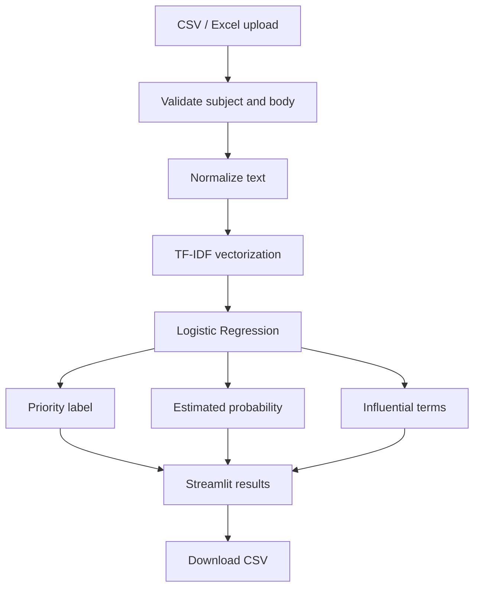

# MailSense AI — project walkthrough

This guide explains the project so its maintainer can understand, demonstrate, and extend it.

## 1. Problem statement

Email inboxes mix time-critical incidents, routine coordination, and optional information. MailSense AI explores whether a text classifier can help a person review a spreadsheet of emails in priority order.

The output is a recommendation, not an automatic action. A human remains responsible for deciding what to read or respond to.

## 2. Scope

**Included**
- Email subject/body input from CSV or Excel.
- Three labels: Urgent, Normal, Low.
- Text normalization and TF-IDF features.
- Logistic Regression classification.
- Estimated class probabilities and indicative terms.
- Summary charts, evaluation report, and CSV export.

**Not included**
- Gmail, Outlook, IMAP, or SMTP connection.
- Sending, deleting, archiving, or moving email.
- Notifications, user accounts, or a production database.

## 3. End-to-end flow



## 4. Why this baseline?

TF-IDF converts a document into numerical features based on term frequency and inverse document frequency. The model uses unigrams and bigrams so it can learn individual words and short phrases.

Logistic Regression is a useful first baseline because it is fast to train, works well with sparse text features, exposes class probabilities, and has coefficients that can be inspected.

A sentence-transformer model may be a useful later experiment, but it should be compared against this baseline on the same independent test set rather than assumed to be better.

## 5. Training and evaluation

The training script:
1. Loads the labelled CSV.
2. Validates required columns and labels.
3. Combines and normalizes subject/body.
4. Creates a stratified train/test split with a fixed random seed.
5. Fits TF-IDF and Logistic Regression as one scikit-learn pipeline.
6. Reports accuracy, macro F1, weighted F1, and per-class precision/recall/F1.
7. Saves the fitted pipeline and evaluation JSON under `artifacts/`.

**Metric meanings**
- Precision: of messages predicted as a class, how many truly belong to it?
- Recall: of messages that truly belong to a class, how many did the model find?
- F1: harmonic mean of precision and recall.
- Macro F1: average F1 treating each class equally.
- Weighted F1: average F1 weighted by each class's support.
- Confusion matrix: counts actual labels against predicted labels.

The bundled dataset is small and synthetic/demo-oriented. Its metrics are only a pipeline smoke check; they do not establish real-world accuracy. A meaningful evaluation needs a larger, representative, independently labelled dataset and careful review for duplicates and leakage.

## 6. Confidence and explanations

The confidence value is the largest class probability returned by Logistic Regression. It is not a guarantee of correctness and may not be calibrated.

The influential terms are derived from the fitted TF-IDF features and the coefficient vector for the predicted class. They are clues about the model's behavior, not causal explanations and not a complete account of the decision.

## 7. Local development

```bash
python -m venv .venv
# Windows PowerShell:
.venv\\Scripts\\Activate.ps1
# macOS/Linux:
# source .venv/bin/activate

python -m pip install --upgrade pip
pip install -r requirements.txt
python train_model.py
pytest -q
streamlit run app.py
```

## 8. Suggested demonstration

1. Launch the app and use the bundled demo emails.
2. Click **Analyze email priorities**.
3. Explain the urgent/normal/low summary.
4. Open the training evaluation section and explain the confusion matrix.
5. Upload a small CSV with `subject` and `body`.
6. Download the resulting CSV.
7. Explain one prediction and why its confidence is not certainty.

## 9. Interview / viva questions

**What is NLP?** Natural Language Processing is the area of computing concerned with analyzing and working with human language.

**What is TF-IDF?** A numerical representation that gives higher weight to terms that are frequent in a document but less common across the document collection.

**Why Logistic Regression?** It is a fast, interpretable baseline for sparse text features and supports probability estimates.

**Why split the data?** To estimate performance on examples not used to fit the model.

**Why stratify?** To keep class proportions approximately consistent in the train and test subsets.

**What is overfitting?** When a model learns training-specific patterns that do not generalize to unseen examples.

**What would you improve next?** Collect a larger labelled dataset, review label quality, use cross-validation, compare TF-IDF with transformer embeddings, calibrate probabilities, and test on a time-separated or otherwise independent dataset.

## 10. Responsible use

Never use this prototype as the sole basis for ignoring an email. Do not upload confidential messages to a shared deployment. Inspect false negatives carefully, especially for the Urgent class.
